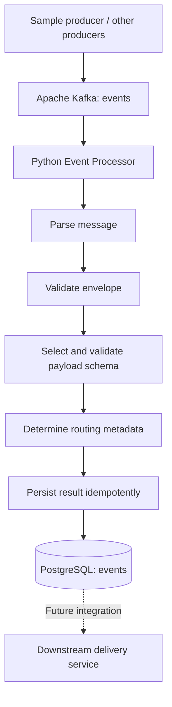

# Event Processor — Design Document

## 1. Problem statement

Build a reactive, multi-tenant Event Processor that consumes events from a messaging system, validates them against declarative contracts, determines routing information, and persists the outcome for a separate downstream delivery service. The processor must not silently discard invalid events and must avoid losing events during failures or shutdown.

The processor is **not** responsible for delivering events to final clients. Its boundary ends when the event and its processing outcome have been durably persisted.

### Scope

**In scope**
- Consume events from Apache Kafka using a Python consumer.
- Support multiple producers, tenants, event types, and schema versions.
- Validate a common envelope and event-specific payloads using JSON Schema.
- Persist valid and invalid events in PostgreSQL with diagnostic context.
- Deduplicate repeated events.
- Handle transient failures, poison messages, and graceful shutdown.
- Provide reproducible local infrastructure and automated tests.

**Out of scope**
- Sending webhooks or other final deliveries to clients.
- A production-grade schema registry, management UI, Kubernetes deployment, or monitoring dashboard.
- Full tenant authentication/authorization infrastructure.

## 2. Architecture overview

### System diagram and component responsibilities



The sample producer is a development utility run independently of the continuously running processor. Kafka and PostgreSQL run under Docker Compose. A one-time `kafka-init` service creates the Kafka topic.

### Component responsibilities

| Component | Responsibility |
| --- | --- |
| Producer | Publish representative valid, invalid, and duplicate events; no business validation required. |
| Kafka | Buffer events, provide partitioned consumption and consumer offsets. |
| Event Processor | Parse, validate, triage, persist, and coordinate acknowledgments. |
| JSON Schemas | Define envelope and versioned payload contracts. |
| PostgreSQL | Store events, outcomes, errors, timestamps, and routing decisions. |
| Delivery service | Future component that reads ready events and delivers them; not implemented here. |

### Event processing flow

1. Poll the `events` Kafka topic using consumer group `event-processor`.
2. Capture the original message bytes and Kafka coordinates (topic, partition, offset).
3. Parse JSON. If parsing fails, prepare an invalid record with the original message and error.
4. Validate the common envelope; if invalid, record the errors without discarding the event.
5. For a valid envelope, resolve and apply the event-specific payload schema.
6. For a valid event, derive routing metadata from `tenant_id` and/or `event_type`. Routing configuration is initially local and explicit.
7. Persist the outcome in a PostgreSQL transaction, using a stable deduplication identity.
8. After the database transaction commits, commit the corresponding Kafka offset.

The initial implementation processes messages sequentially per consumer to simplify offset correctness. If concurrency is added later, offsets must not advance beyond an earlier unpersisted message in the same partition.

**Partitioning and scaling.** Producers key messages by `tenant_id`, so one tenant's events land on one partition and are processed in order. The topic has 3 partitions. Throughput scales by running more processor instances in the same consumer group (up to the partition count) rather than adding threads, which also sidesteps Python's GIL.

### Processing outcomes

| Condition | Database outcome | Kafka offset |
| --- | --- | --- |
| Valid event | `READY`, with routing metadata | Commit after DB commit |
| Schema validation failure | `INVALID`, with validation errors | Commit after DB commit |
| Unknown event type or schema version | `INVALID`, with diagnostic error | Commit after DB commit |
| Malformed JSON | `INVALID`, preserve raw message | Commit after DB commit |
| Duplicate event | No second logical event row | Commit after deduplication is confirmed |
| Temporary PostgreSQL failure | No acknowledged result | Do not commit; retry/replay |
| Unexpected persistent processing failure | Record `FAILED` if possible, otherwise retain message for retry | Commit only after durable disposition |

### Event statuses

| Status | Set by | Meaning |
| --- | --- | --- |
| `READY` | Processor | Passed validation, ready for downstream delivery. |
| `INVALID` | Processor | Failed envelope or payload validation. Stored with the errors. |
| `FAILED` | Processor | A terminal processing error that was successfully recorded. |
| `DELIVERED` | Delivery service | Delivered to the client. Never written by the processor. |

```text
Kafka ─► Processor ─┬─► READY ─► DELIVERED (delivery service)
                    ├─► INVALID
                    └─► FAILED
```

### Event contracts and schema versioning

Each Kafka message is a JSON event containing common metadata (the **envelope**) and a type-specific `payload`.

```json
{
  "event_id": "event_001",
  "event_type": "payment.authorized",
  "tenant_id": "tenant-001",
  "schema_version": "1.0",
  "occurred_at": "2026-10-18T10:00:00Z",
  "payload": {
    "transaction_id": "txn-100",
    "amount": 150.50,
    "currency": "USD"
  }
}
```

Required envelope fields: `event_id` (nonempty string, e.g. `event_001`), `event_type`, `tenant_id`, `schema_version` (`MAJOR.MINOR`), `occurred_at` (date-time), and `payload` (object).

Schemas are stored in the repository:

```text
schemas/
  envelope.json
  payment.authorized/
    1.0.json
  monitoring.alert/
    1.0.json
```

- `payment.authorized` requires `transaction_id` (nonempty string), `amount` (number greater than zero), and `currency` (three uppercase letters).
- `monitoring.alert` requires `service` (nonempty string), `severity` (`info`, `warning`, or `critical`), and `message` (nonempty string).
- Payload schemas do not set `additionalProperties: false`: unknown extra fields are accepted, favouring forward compatibility.
- Unknown event types or schema versions produce an invalid result rather than being silently dropped.
- Date-time format checks require an explicitly configured JSON Schema format checker.

The processor first validates the envelope, then selects the payload contract using `(event_type, schema_version)`. The registry loads all schema files at startup into a dictionary keyed by that pair; a broken schema file fails startup, and values from messages are never used to build file paths. **Adding an event type means adding a schema file, not changing code.** Payload schema selection is independent of Kafka topic names.

### Persistence model

A single PostgreSQL `events` table holds valid and invalid events (see `db/init.sql`). The envelope is uniform and only the payload varies, so per-type tables would need DDL for every new event type, and one table gives the delivery service a single queue to read.

| Column | Type | Purpose |
| --- | --- | --- |
| `id` | `BIGINT GENERATED ALWAYS AS IDENTITY` | Internal primary key; usable as a cursor |
| `event_id` | `TEXT NOT NULL UNIQUE` | Logical event identity for idempotency |
| `tenant_id` | `TEXT` nullable | Event owner; nullable for invalid envelopes |
| `event_type` | `TEXT` nullable | Event classification |
| `schema_version` | `TEXT` nullable | Contract version |
| `occurred_at` | `TIMESTAMPTZ` nullable | When the event happened at the producer |
| `payload` | `JSONB` nullable | Parsed payload; NULL if unparseable |
| `raw_message` | `BYTEA` nullable | Original bytes for diagnostics |
| `status` | `TEXT NOT NULL` | `READY`, `INVALID`, `FAILED`, or `DELIVERED` (CHECK constraint) |
| `validation_errors` | `JSONB` nullable | Structured validation failures |
| `routing_targets` | `JSONB` nullable | Selected destination or routing decision |
| `received_at` | `TIMESTAMPTZ NOT NULL` | When the consumer received the message |
| `processed_at` | `TIMESTAMPTZ NOT NULL` | When processing completed |
| `source_topic`, `source_partition`, `source_offset` | `TEXT`, `INTEGER`, `BIGINT` | Kafka coordinates for troubleshooting |

Envelope columns are nullable on purpose: a malformed message may lack them and must still be stored.

**Idempotency.** Writes use `INSERT ... ON CONFLICT (event_id) DO NOTHING`. A unique constraint on `event_id` is appropriate only if producer IDs are globally unique; if IDs are tenant-scoped, use a tenant-aware deduplication key. For messages lacking an event ID, a stable fallback identity is derived from Kafka topic, partition, and offset with a reserved prefix, so it cannot collide with producer-assigned IDs. Do not silently overwrite the first event when a duplicate ID arrives with different content; log or otherwise surface the conflict.

**Indexes**, each tied to a query:

| Index | Query it serves |
| --- | --- |
| `UNIQUE (event_id)` | Idempotent insert (`ON CONFLICT`). |
| `(received_at, id) WHERE status = 'READY'` | Delivery service: next chronological batch of ready events. Partial, so it stays small as history grows. |
| `(tenant_id, received_at)` | Troubleshooting: a tenant's recent events. |

Additional indexes should follow actual query patterns, because every index adds insert overhead.

**Initialization.** PostgreSQL initialization SQL lives in `./db/init.sql`, mounted into `/docker-entrypoint-initdb.d`. It runs automatically only when the database volume is first initialized; later schema changes require a deliberate migration process.

### Tenant routing

`tenant_id` identifies the event owner and can determine a delivery destination. For the first version, a small local configuration mapping is sufficient, for example:

```text
tenant-001 -> destination-A
tenant-002 -> destination-B
```

The processor records the decision in `routing_targets` but does not perform final delivery. A nonempty tenant identifier is not proof of tenant authorization; production systems would require a trusted tenant registry and access controls. The behavior for unknown tenants should be explicit (for example, persist `INVALID` with a routing error).

### Local deployment

The Compose environment contains:

| Service | Behavior |
| --- | --- |
| `kafka` | Kafka 3.8.0 in single-node KRaft mode; internal `kafka:19092`, host `localhost:9092` |
| `kafka-init` | Creates topic `events`, 3 partitions, replication factor 1; exits after completion |
| `postgres` | PostgreSQL 16, database/user `events`; initializes schema on first volume creation |
| `event-processor` | Python service to be added; consumes from `kafka:19092` and writes to `postgres:5432` |

The sample producer can run on the host and connect to `localhost:9092`. Kafka and PostgreSQL use named Docker volumes. Local development credentials must not be reused in production.

## 3. Key design decisions

### Technology choices and rationale

| Concern | Choice | Reason |
| --- | --- | --- |
| Implementation | Python | Familiarity and clear separation of processing components. |
| Broker | Apache Kafka 3.8.0, KRaft mode | Event-driven consumption, durable logs, offsets, consumer groups, and replay. |
| Kafka client | `confluent-kafka` | Standard Kafka protocol client with explicit poll/commit control. |
| Validation | JSON Schema Draft 2020-12 and `jsonschema` | Declarative, versioned contracts without a schema registry. |
| Storage | PostgreSQL 16 | Transactional persistence, unique constraints, JSONB, and indexes. |
| Database client | `psycopg` | PostgreSQL access and transaction management. |
| Local environment | Docker Compose | Reproducible single-machine development and tests. |
| Testing | pytest | Unit and integration tests. |

### Alternatives considered and trade-offs

| Decision | Chosen approach | Alternative / trade-off |
| --- | --- | --- |
| Broker | Apache Kafka | Redpanda is compatible and lighter locally, but Kafka is the reference implementation. Kinesis on LocalStack matches AWS, but shard handling and checkpointing need more machinery in Python. SQS offers no ordering or replay. |
| Delivery semantics | At-least-once plus idempotent write | Kafka transactions cannot span the external database, so they would not remove the need for an idempotent write. |
| Schema contracts | JSON Schema files | Avro/Protobuf and a schema registry add compact encoding and stricter evolution rules but also complexity. |
| Database | PostgreSQL, single table | DynamoDB scales horizontally and supports conditional writes, but "oldest ready events" needs careful index design and ad hoc queries are harder. A second Kafka topic is weak for deduplication and status lookups. Redis has weaker durability. |
| Invalid events | Same `events` table | A DLQ adds replay tooling but is not needed for the initial validation-failure path. |
| Partition key | `tenant_id` | Per-tenant ordering and load spread across instances; a very large tenant becomes a hot partition. |
| Processing model | Sequential per consumer, scale via consumer group | Parallel processing improves throughput but complicates ordered offset commits. |
| Routing | Local configuration | Database-driven tenant routing is more dynamic but needs additional management and authorization. |
| Language | Python | The original assignment prefers Go; Python is used here following recruiter approval. |

## 4. Failure modes

### At-least-once processing

Kafka offsets are committed **only after** successful PostgreSQL persistence. A crash between the database commit and the Kafka offset commit may cause redelivery, so database-level idempotency is essential. Kafka and PostgreSQL do not share a distributed transaction in this design; exactly-once end-to-end delivery is not claimed.

### Transient failures

Database connection failures or temporary infrastructure problems trigger bounded retries with exponential backoff, and the offset is not committed meanwhile. The consumer must not acknowledge a message that has not reached a durable disposition. If processing is blocked, the consumer should avoid unbounded in-memory buffering and remain mindful of Kafka consumer poll/rebalance behavior.

### Poison messages

Malformed or schema-invalid events are expected business-validation outcomes and are persisted as `INVALID`, not endlessly retried. Unexpected processing failures follow a bounded retry policy. If they still fail, the failure is recorded as a `FAILED` row with the raw message and the reason, and the offset is then committed so the partition is not blocked. A separate Kafka DLQ is not part of the initial design because PostgreSQL already records these events; adding a DLQ is an optional extension.

### Graceful shutdown

On SIGTERM, stop taking new work, finish the in-flight message (persist, then commit its offset only if the database transaction committed), and close the consumer so the group rebalances promptly, then close database connections. Unacknowledged messages remain eligible for replay.

### Broker and database durability limits

The local Compose environment uses one Kafka broker and one PostgreSQL instance. Persistent Docker volumes help survive container recreation, but they do not provide multi-node fault tolerance or protection against host/disk failure.

### Failure summary

| Failure | Behaviour |
| --- | --- |
| Message is not valid JSON | Stored as `INVALID` with raw bytes. Offset committed. |
| Envelope fields missing | Stored as `INVALID` with errors. Fallback key from topic/partition/offset. |
| Unknown `event_type` or `schema_version` | Stored as `INVALID` ("no schema registered"). |
| Payload violates schema | Stored as `INVALID` with the error list. |
| Duplicate delivery (same `event_id`) | `ON CONFLICT DO NOTHING`. One row. |
| Crash after persist, before commit | Redelivered, deduplicated by `event_id`. |
| Crash before persist | Offset not committed, event re-read and stored. |
| PostgreSQL temporarily down | Retry with backoff. Offset not committed. Events wait in Kafka. |
| Persistent error on one message | After retries, recorded as `FAILED`, offset committed, partition continues. |
| Kafka broker down | Client reconnects; nothing is processed until it returns. |
| Consumer group rebalance | Offsets are committed per message after persist, so a new owner resumes after the last stored event. |
| Broken schema file | Startup fails fast, so the service never runs with partial contracts. |

## 5. Known limitations

- Single Kafka broker (replication factor 1) and PostgreSQL instance: not highly available. Write throughput is bounded by one database node.
- Static, repository-managed schemas and routing rules. Schema versioning is by exact match, with no compatibility checking between versions.
- No actual downstream delivery or delivery-attempt tracking; `DELIVERED` exists in the schema but nothing sets it here.
- No tenant authentication, authorization, or PostgreSQL row-level security.
- No dedicated DLQ/replay administration workflow in the initial scope; `FAILED` rows can be inspected but re-driving them is manual.
- No throughput benchmark or production capacity plan yet. Per-message offset commits are simple and safe but limit throughput; batching commits is a future optimisation.
- Unbounded table growth: no retention, archival, or partitioning. Time-partitioning would force the primary key to include the partition column and weaken `event_id` deduplication, which is a real trade-off.
- No ordering guarantee across tenants, and `id` order only approximates commit order with several processors. Keying by `tenant_id` can overload one partition for a very large tenant.
- `READY` rows need a lifecycle/claiming strategy when a delivery service is introduced (for example `FOR UPDATE SKIP LOCKED`); multiple delivery workers must not independently deliver the same row without coordination.
- Floating-point amounts in `payment.authorized` (JSON number); integer minor units or decimal strings would be safer for arithmetic.
- `db/init.sql` runs only on an empty volume; a real project would use a migration tool such as Alembic or Flyway.
- No metrics, tracing, or alerting beyond structured logs.
- Exactly-once delivery to external clients is outside scope.

## 6. Verification and delivery plan

### Testing strategy

**Unit tests**
- Valid and invalid envelope validation.
- Payment and monitoring payload validation.
- Unsupported event type/schema version.
- Routing decisions for known and unknown tenants.
- Stable deduplication identity selection.

**Integration tests**
- Publish a valid event and verify a `READY` row.
- Publish an invalid payload and verify an `INVALID` row with errors.
- Publish malformed JSON and verify that the raw message is retained.
- Publish a duplicate event and verify that no second logical row appears.
- Simulate database unavailability; verify the Kafka offset is not committed prematurely and the event can be replayed.
- Restart the processor during processing; verify no message is lost.
- Verify multi-tenant routing metadata and handling of unsupported versions.

Tests should run with a single documented command. Record the actual command and results in `README.md` once implemented.

### Development milestones

1. **Infrastructure and contracts:** Compose, Kafka topic, PostgreSQL initialization, envelope and two payload schemas.
2. **Producer and consumer:** Publish representative events and consume from Kafka.
3. **Validation and routing:** Envelope/payload validation, schema selection, tenant-aware routing.
4. **Persistence:** Transactional inserts, invalid-event storage, uniqueness constraints, indexes.
5. **Reliability:** Manual offset commits, retries, poison-message handling, shutdown behavior.
6. **Verification and documentation:** Unit/integration tests, README instructions, design review, and milestone commits.

### Submission checklist

- [ ] Public repository with meaningful milestone commits.
- [ ] Working processor and reproducible Docker Compose environment.
- [ ] Versioned JSON Schemas and database initialization SQL.
- [ ] One-command automated tests with documented prerequisites.
- [ ] Verified invalid-event persistence and idempotency.
- [ ] Verified failure recovery and graceful shutdown.
- [ ] README with setup, producer invocation, test command, and verification queries.
